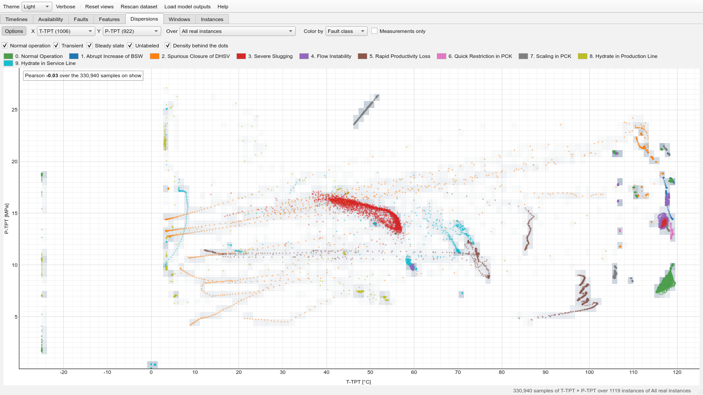

# Dispersions page
Two sensors against each other, every sample of the instances of a scope one
dot, the density of the samples shaded behind. It is the scatter plot of Melo's exploratory
methodology made readable: his figures of two 3W variables (thesis, section 4.2.5) were where he
saw the historian's hand, the cloud of two interpolated series being the trajectories of the two
interpolations, straight segments between the few instants that were measured. A static scatter
of a million points is a smear; this one names the instance and the instant of every dot on hover
and lights up every other dot of that instance, opens the instance on a click, and thins itself to
the measurements alone
([`algorithms/dispersion.py`](../../src/well_data_viewer/algorithms/dispersion.py),
[`frontend/dispersion_page.py`](../../src/well_data_viewer/frontend/dispersion_page.py)).

- **Options**, at the left of the toolbar, shows and hides **Color by**, **Measurements only** and
  the row of the label periods and the density; **X**, **Y**, **Class**, **Well** and the color key, on a row
  of its own that wraps when the window is narrow, stay in view.
- **X**, **Y** are the two sensors (analog ones; readings outside the plausible range left out), and
  **Class** and **Well** the scope, which they narrow together: one fault class, one well, or the
  instances of one class on one well, *All* in either box lifting that condition. Each box counts
  the instances under the other's choice and greys out what has none there, so that a scope with no
  instance cannot be chosen (*All* in the other box brings it back). A class's cloud colored by
  well shows which well each cluster comes from; choosing that well in **Well** keeps it alone, the
  class still chosen, and the view stays where it was: only a change of **X** or **Y** frames the
  plot afresh (**Reset views** frames the dots on show). The first look at a scope reads its instances in full behind a progress
  dialog, every analog sensor at once, and keeps an even subsample of the rows for the session,
  400,000 in all (one row in a few for one well, one in fifty for the whole dataset, which takes
  about two minutes), so that everything else is instant; at most 150,000 of them are drawn as
  dots, evenly, and the **density** behind the dots, a two-dimensional histogram on a logarithmic
  scale, counts them all.
- **Color by** colors the dots by fault class, by well or by label period, or shows the density
  alone; the **Normal operation**, **Transient**, **Steady state** and **Unlabeled** boxes switch
  those samples on and off, so that a fault's steady state alone shows the relation under
  the fault and normal operation alone the relation it departs from.
- **Measurements only** keeps the samples at which both sensors were actually read, a few per cent
  of the dots, from which the historian's straight trajectories vanish. It carries a caveat of its
  own: a historian archives a reading when it has moved enough, so the instants at which both
  sensors were archived are instants at which both moved, and this cloud favours the relation
  between them: over the severe-slugging instances P-TPT × T-TPT reads +0.40 on every sample and
  +0.95 on the 5 % at which both were measured. The caption gives the counts, one in how many; the
  Pearson coefficient over the samples on show sits in the top-left corner of the plot.
- **The coefficient is an approximation.** The subsample takes about as many rows of every
  instance, however long the instance is, so the cloud, its density and the coefficient in the
  corner weigh the instances alike rather than the samples. Where the instances of a scope differ
  in length and in the relation they show, the coefficient strays from the one over every sample:
  over the transients of Hydrate in Production Line, P-MON-CKP × P-PDG reads +0.71 on the page and
  +0.87 over every sample. The box's tooltip and the help say the same.
- **Hover** a dot for its instance, its instant, its label period, its two readings and whether
  each was measured or filled in. Every other dot of that instance is brought forward and the rest
  of the cloud fades, so one recording's trajectory through the plane can be followed with the
  eye; the status bar counts the dots of it on show and the samples in the density cell under the
  pointer. **Click** a dot to open its instance in the instance window on the two sensors of the
  plot, X and Y ticked and nothing else, so that the relation read in the plane can be followed in
  time (the feature boxes take it from there). Pooling wells carries its usual caveat: two
  clouds side by side may be two wells rather than one relation, and *Color by: Well* tells them
  apart.