# UML diagrams

<!-- Written by scripts/uml.py from the source code; do not edit by hand. Run `uv run python scripts/uml.py` after changing a class. -->

The structure of the `well_data_viewer` package, read off its source code by [`scripts/uml.py`](https://github.com/Thiago-TP/3w-well-data-viewer/blob/main/scripts/uml.py) and checked against it by the test suite. A layer whose classes are built from one another has an overview of how, by name; every module then has a diagram of its classes with their public attributes and methods.

- Inheritance (`<|--`) is drawn between the package's own classes; a base from outside (Qt, pyqtgraph, `NamedTuple`) is the class's stereotype instead, as is `<<dataclass>>`.
- Composition (`*--`) is an instance a class creates and keeps, aggregation (`o--`) one it keeps but was handed; in a module's diagram each is labeled with the attribute that holds it.
- A class of another module appears as a bare box; its own module's diagram has its members.

## Packages

The three layers and the entry points; an arrow is the imports from the modules of one to the modules of the other.

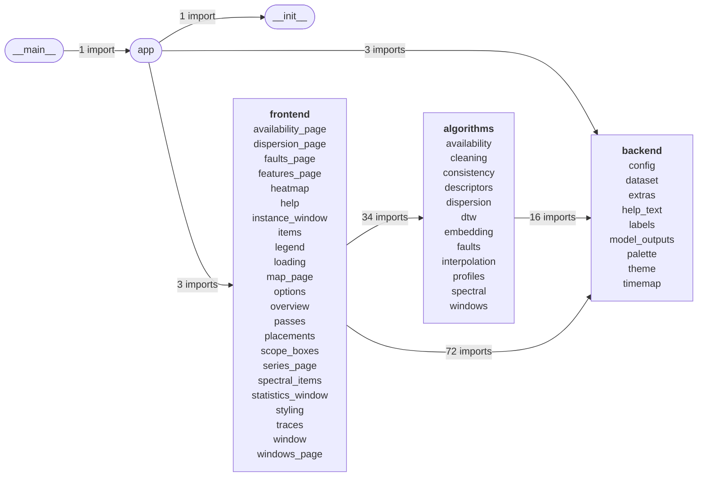

## Algorithms

What is computed, from arrays and frames; no Qt. 28 classes in 10 modules. None of them is built from another: they hold data, and each module's diagram shows what they hold.

### algorithms.availability

`AvailabilityTable`, `Availability`, `PairTable`, `PairCoverage`.

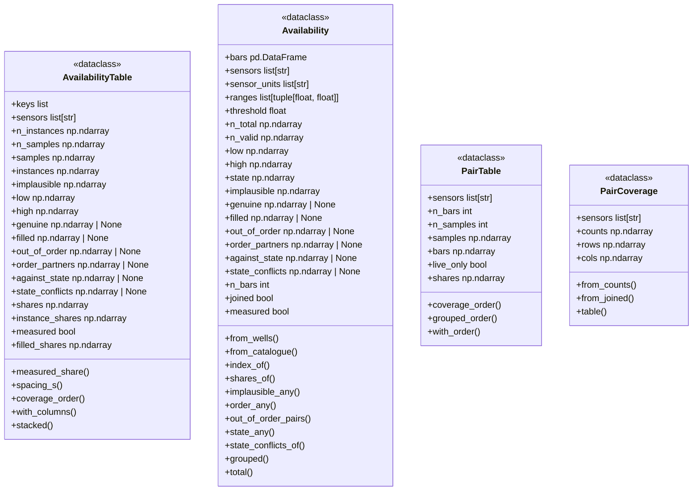

### algorithms.cleaning

`CleanRule`, `Cleaning`, `Cleaned`.

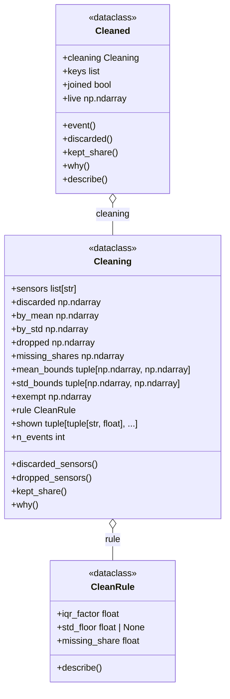

### algorithms.consistency

`PressureOrder`, `OrderBreak`, `StateBreak`.

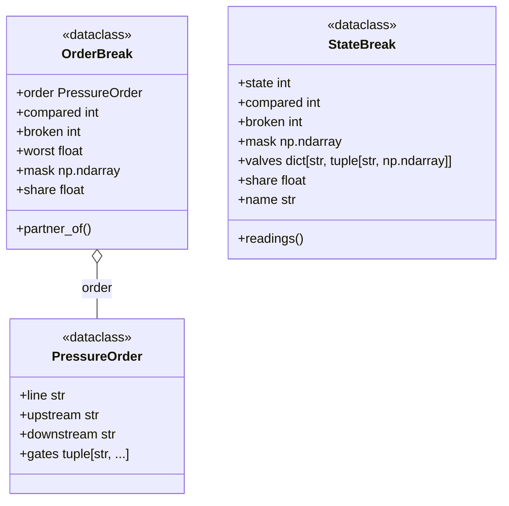

### algorithms.descriptors

`Descriptors`.

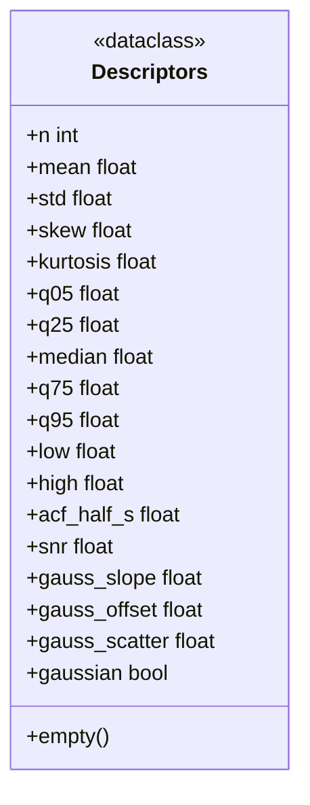

### algorithms.dispersion

`InstanceRef`, `Pair`, `Cloud`, `DispersionPass`.

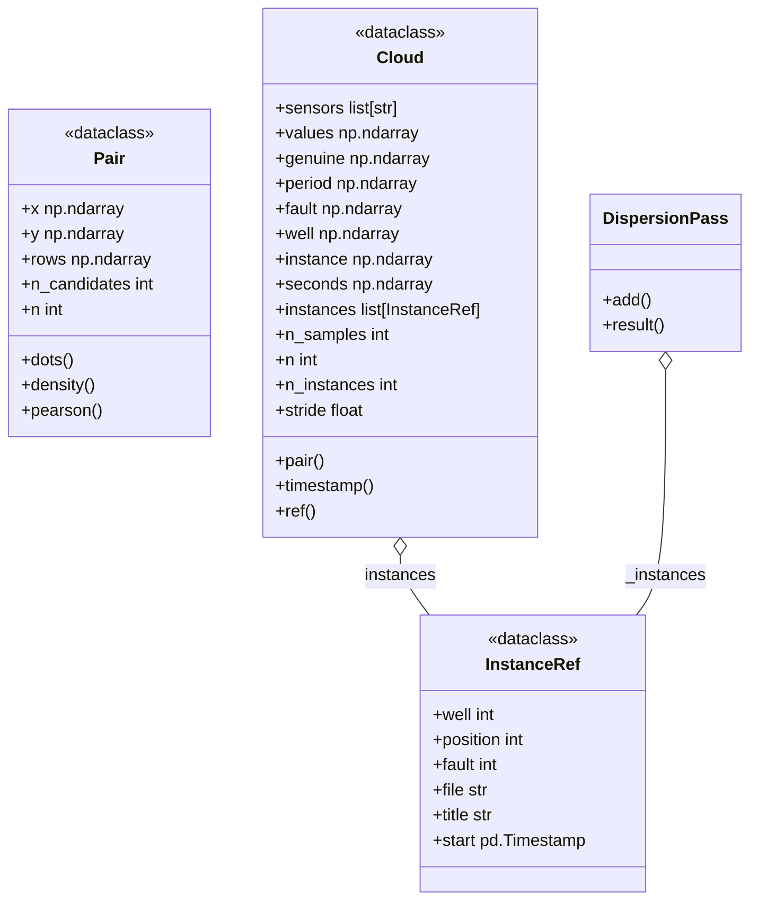

### algorithms.embedding

`Representation`, `ClusterScores`, `Typicality`, `Novelty`.

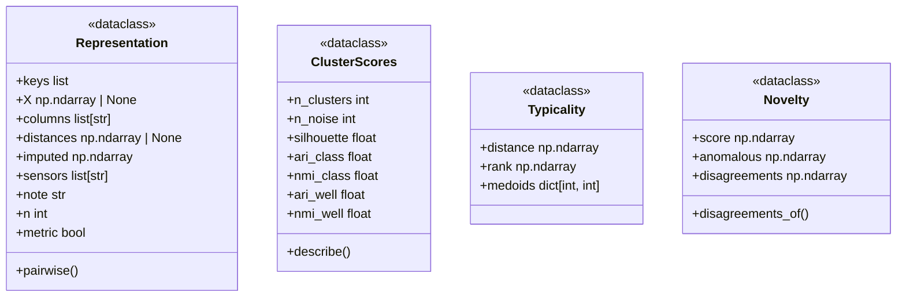

### algorithms.interpolation

`Sampling`.

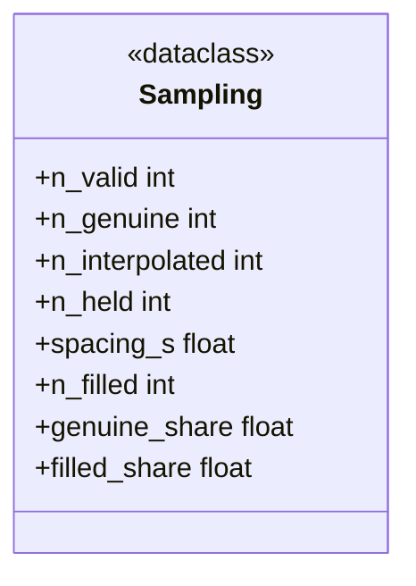

### algorithms.profiles

`DescriptorChoice`, `Profiles`.

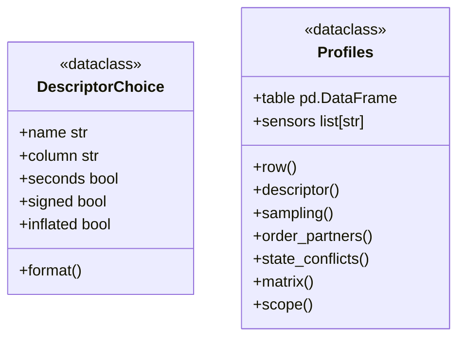

### algorithms.spectral

`TransformParams`, `Spectrum`, `Histogram`.

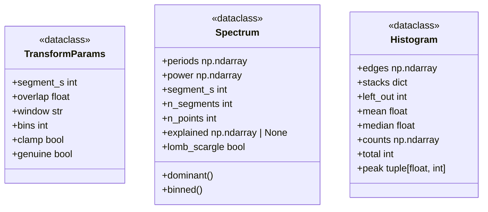

### algorithms.windows

`Windows`, `WellSeries`, `SeriesPass`.

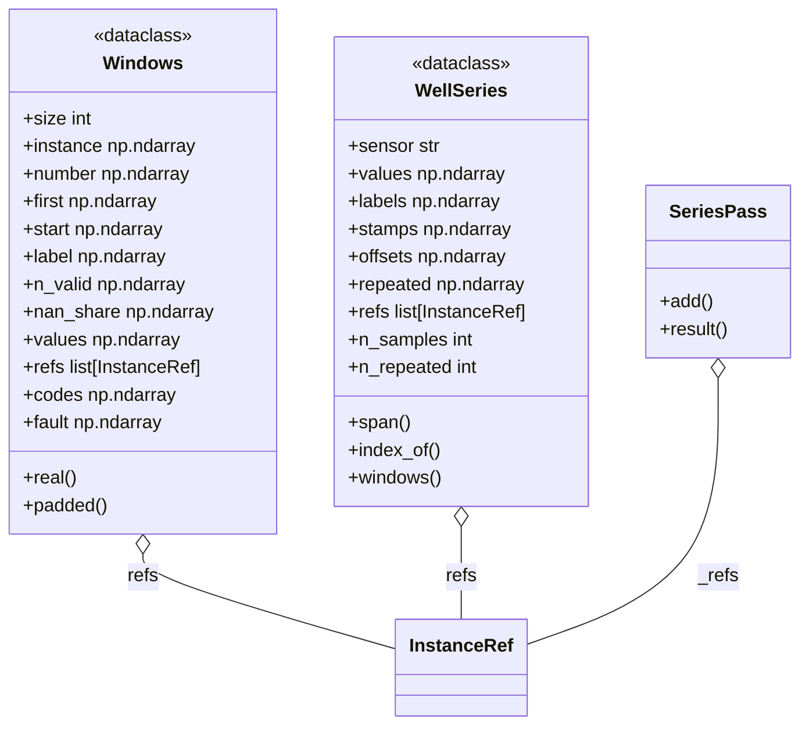

## Backend

The dataset, the passes over it and their caches; no Qt. 16 classes in 8 modules. None of them is built from another: they hold data, and each module's diagram shows what they hold.

### backend.dataset

`ScanCancelled`, `DatasetInfo`, `WellData`, `BarStats`.

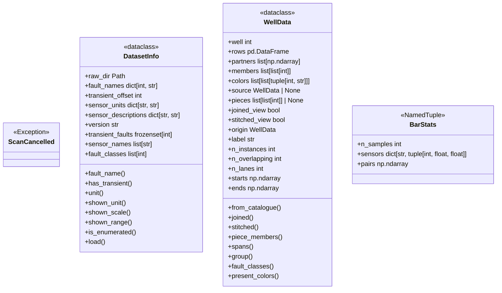

### backend.extras

`Extra`.

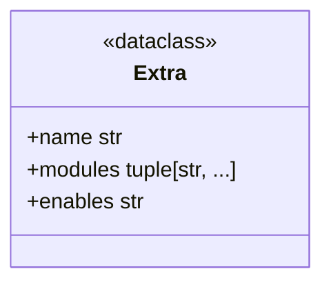

### backend.help_text

`Figure`, `FaultHelp`, `VariableHelp`.

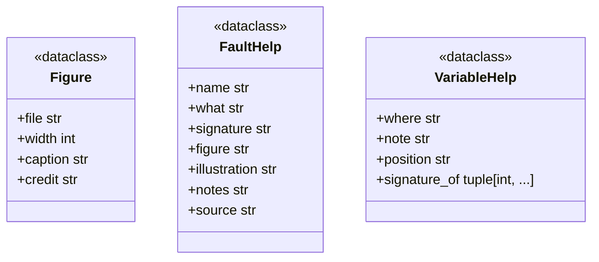

### backend.labels

`Segment`, `FeatureStats`.

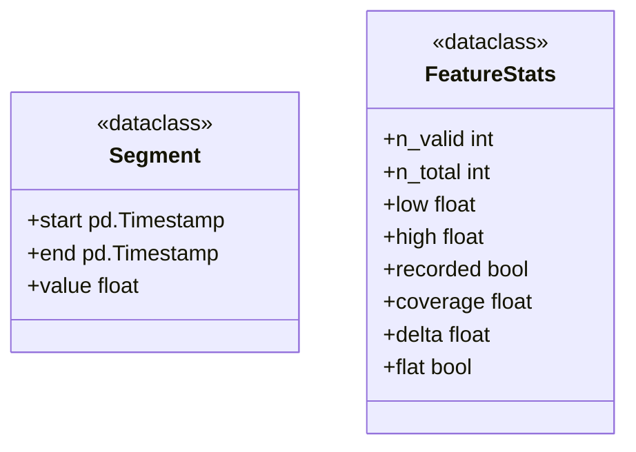

### backend.model_outputs

`ModelSpec`, `Agreement`, `ModelOutputs`.

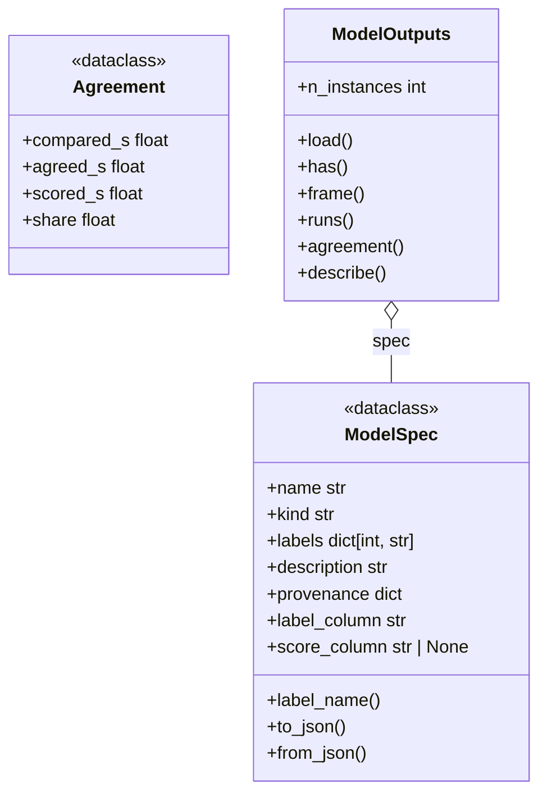

### backend.palette

`LegendEntry`.

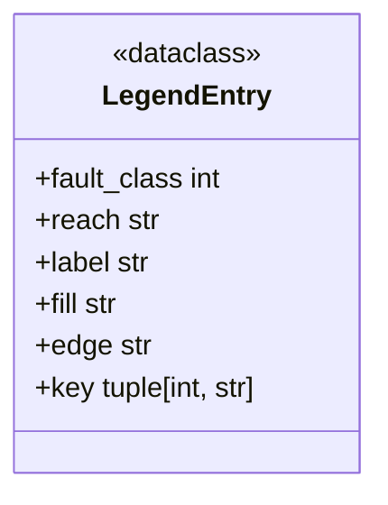

### backend.theme

`Theme`.

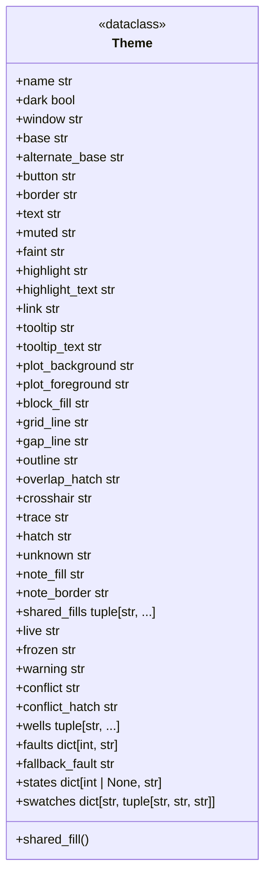

### backend.timemap

`TimeMap`.

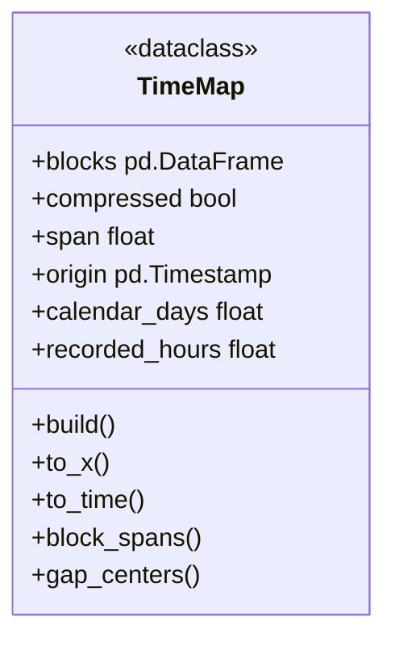

## Frontend

The windows, the pages and the widgets and plot items they are made of. 59 classes in 23 modules. The overview draws how they are built from one another, inheritance and composition, leaving out the classes many others build (`ElidedLabel`, `OptionsAction`); the modules' diagrams have the rest.

```mermaid
classDiagram
  direction LR
  class AvailabilityPage {
    <<QWidget>>
  }
  class DispersionPage {
    <<QWidget>>
  }
  class FaultsPage
  class FeaturesPage
  class ColorKey {
    <<QWidget>>
  }
  class HeatmapWidget {
    <<QWidget>>
  }
  class StateKey {
    <<QWidget>>
  }
  class HelpWindow {
    <<QDialog>>
  }
  class InstanceWindow {
    <<QMainWindow>>
  }
  class PlotStack {
    <<GraphicsLayoutWidget>>
  }
  class AnchoredText {
    <<TextItem>>
  }
  class InstanceBarsItem {
    <<GraphicsObject>>
  }
  class SegmentsItem {
    <<GraphicsObject>>
  }
  class TimeAxisItem {
    <<AxisItem>>
  }
  class WheelToParent
  class FlowLayout {
    <<QLayout>>
  }
  class LegendBar {
    <<QWidget>>
  }
  class FrameCache
  class MapPage {
    <<QWidget>>
  }
  class VerboseAction {
    <<QAction>>
  }
  class TimelinesPage {
    <<QWidget>>
  }
  class WellTimelinePlot {
    <<PlotWidget>>
  }
  class ModelResults {
    <<dataclass>>
  }
  class Passes
  class PlacementChecks {
    <<QWidget>>
  }
  class ScopeBoxes {
    <<QObject>>
  }
  class InstanceList {
    <<QListWidget>>
  }
  class SeriesPage {
    <<QWidget>>
  }
  class TransformControls {
    <<QWidget>>
  }
  class StatisticsWindow {
    <<QDialog>>
  }
  class MainWindow {
    <<QMainWindow>>
  }
  class ThumbnailGrid {
    <<GraphicsLayoutWidget>>
  }
  class WindowsModel {
    <<QAbstractTableModel>>
  }
  class WindowsPage {
    <<QWidget>>
  }
  AvailabilityPage *-- StateKey
  AvailabilityPage *-- HeatmapWidget
  AvailabilityPage *-- ScopeBoxes
  DispersionPage *-- ColorKey
  DispersionPage *-- AnchoredText
  DispersionPage *-- ScopeBoxes
  SeriesPage <|-- FaultsPage
  FaultsPage *-- PlacementChecks
  FaultsPage *-- InstanceList
  SeriesPage <|-- FeaturesPage
  FeaturesPage *-- InstanceList
  ColorKey *-- FlowLayout
  InstanceWindow *-- HelpWindow
  InstanceWindow *-- StatisticsWindow
  InstanceWindow *-- VerboseAction
  InstanceWindow *-- TransformControls
  InstanceWindow *-- PlotStack
  InstanceWindow *-- PlacementChecks
  WheelToParent <|-- PlotStack
  LegendBar *-- FlowLayout
  TimelinesPage *-- StateKey
  TimelinesPage *-- LegendBar
  WheelToParent <|-- WellTimelinePlot
  WellTimelinePlot *-- TimeAxisItem
  WellTimelinePlot *-- SegmentsItem
  WellTimelinePlot *-- InstanceBarsItem
  Passes *-- FrameCache
  Passes *-- ModelResults
  SeriesPage *-- PlotStack
  SeriesPage *-- TransformControls
  MainWindow *-- FrameCache
  MainWindow *-- Passes
  MainWindow *-- HelpWindow
  MainWindow *-- TimelinesPage
  MainWindow *-- AvailabilityPage
  MainWindow *-- FaultsPage
  MainWindow *-- FeaturesPage
  MainWindow *-- DispersionPage
  MainWindow *-- WindowsPage
  MainWindow *-- MapPage
  MainWindow *-- VerboseAction
  WheelToParent <|-- ThumbnailGrid
  WindowsPage *-- WindowsModel
  WindowsPage *-- ThumbnailGrid
```

### frontend.availability_page

`AvailabilityPage`.

```mermaid
classDiagram
  class AvailabilityPage {
    <<QWidget>>
    +pairs bool
    +live_pairs bool
    +joined bool
    +split bool
    +cleaning_on bool
    +clean_rule CleanRule
    +availability Availability | None
    +pair_coverage PairCoverage | None
    +mode str
    +by_instances bool
    +set_verbose()
    +apply_theme()
    +hint()
    +set_catalogue()
    +show_instances_of()
    +summary()
    +tooltip()
  }
  class Availability
  class AvailabilityTable
  class Cleaned
  class DatasetInfo
  class HeatmapRow
  class HeatmapWidget
  class OptionsAction
  class PairCoverage
  class PairTable
  class Passes
  class Profiles
  class ScopeBoxes
  class StateKey
  class WellData
  AvailabilityPage o-- DatasetInfo : info
  AvailabilityPage o-- Passes : _passes
  AvailabilityPage o-- WellData : _wells
  AvailabilityPage o-- WellData : _well_by_number
  AvailabilityPage o-- Availability : _plain
  AvailabilityPage o-- Availability : _joined
  AvailabilityPage o-- PairCoverage : _pairs
  AvailabilityPage o-- PairCoverage : _joined_pairs
  AvailabilityPage o-- Profiles : _profiles
  AvailabilityPage o-- Cleaned : _cleaned
  AvailabilityPage o-- AvailabilityTable : _table
  AvailabilityPage o-- PairTable : _pair_table
  AvailabilityPage o-- HeatmapRow : _rows
  AvailabilityPage *-- StateKey : _key
  AvailabilityPage *-- StateKey : _pair_key
  AvailabilityPage *-- HeatmapWidget : _heatmap
  AvailabilityPage *-- OptionsAction : options
  AvailabilityPage *-- ScopeBoxes : _scope
```

### frontend.dispersion_page

`DispersionPage`.

```mermaid
classDiagram
  class DispersionPage {
    <<QWidget>>
    +x str | None
    +y str | None
    +coloring str
    +genuine_only bool
    +periods list[int]
    +fault int
    +well int
    +hint()
    +set_verbose()
    +apply_theme()
    +set_scope()
    +set_catalogue()
    +showEvent()
    +summary()
    +reset_views()
    +describe()
    +wait_cursor()
  }
  class AnchoredText
  class Availability
  class Cloud
  class ColorKey
  class DatasetInfo
  class ElidedLabel
  class OptionsAction
  class Pair
  class Passes
  class ScopeBoxes
  class WellData
  DispersionPage o-- DatasetInfo : info
  DispersionPage o-- Passes : _passes
  DispersionPage o-- WellData : _wells
  DispersionPage o-- Availability : _availability
  DispersionPage o-- Cloud : _clouds
  DispersionPage o-- Cloud : _cloud
  DispersionPage o-- Pair : _pair
  DispersionPage *-- ColorKey : _key
  DispersionPage *-- AnchoredText : _pearson
  DispersionPage *-- ElidedLabel : _note
  DispersionPage *-- OptionsAction : options
  DispersionPage *-- ScopeBoxes : _scope
```

### frontend.faults_page

`FaultsPage`.

```mermaid
classDiagram
  class FaultsPage {
    +fault int | None
    +on_model_results()
    +on_sort_changed()
    +apply_theme()
    +verbose_widgets()
    +set_catalogue()
    +ready()
    +selected_features()
    +before_replot()
    +load_series()
    +sections()
    +read_out_features()
    +empty_message()
    +series_headline()
    +pool_headline()
    +summary()
  }
  class Availability
  class FrameCache
  class InstanceList
  class PlacementChecks
  class SeriesPage
  class WellData
  SeriesPage <|-- FaultsPage
  FaultsPage o-- FrameCache : _frames
  FaultsPage o-- WellData : _wells
  FaultsPage o-- Availability : _availability
  FaultsPage *-- PlacementChecks : _placements
  FaultsPage *-- InstanceList : _list
```

### frontend.features_page

`FeaturesPage`.

```mermaid
classDiagram
  class FeaturesPage {
    +colors_by_well bool
    +feature str | None
    +well_filter int | None
    +on_model_results()
    +on_sort_changed()
    +verbose_widgets()
    +apply_theme()
    +set_color_by()
    +set_catalogue()
    +ready()
    +selected_classes()
    +before_replot()
    +load_series()
    +sections()
    +pool_key()
    +pool_headline()
    +read_out_features()
    +empty_message()
    +section_note()
    +series_headline()
    +summary()
  }
  class Availability
  class FrameCache
  class InstanceList
  class SeriesPage
  class WellData
  SeriesPage <|-- FeaturesPage
  FeaturesPage o-- FrameCache : _frames
  FeaturesPage o-- WellData : _wells
  FeaturesPage o-- Availability : _availability
  FeaturesPage *-- InstanceList : _list
```

### frontend.heatmap

`HeatmapRow`, `StateKey`, `ColorKey`, `HeatmapWidget`.

```mermaid
classDiagram
  class HeatmapRow {
    <<dataclass>>
    +label str
    +swatch str | None
    +emphasized bool
  }
  class StateKey {
    <<QWidget>>
    +set_text()
    +set_visible()
    +apply_theme()
  }
  class ColorKey {
    <<QWidget>>
    +set_entries()
    +apply_theme()
  }
  class HeatmapWidget {
    <<QWidget>>
    +rows list[HeatmapRow]
    +columns list[str]
    +cell_width int
    +set_matrix()
    +set_tooltip_provider()
    +event()
    +sizeHint()
    +resizeEvent()
    +cell_rect()
    +hit()
    +paintEvent()
    +mouseMoveEvent()
    +leaveEvent()
    +mousePressEvent()
  }
  class FlowLayout
  ColorKey *-- FlowLayout : _layout
  HeatmapWidget o-- HeatmapRow : _rows
```

### frontend.help

`Figures`, `HelpWindow`.

```mermaid
classDiagram
  class Figures {
    +html()
    +attach()
  }
  class HelpWindow {
    <<QDialog>>
    +show_tab()
  }
```

### frontend.instance_window

`BandSegments`, `PlotStack`, `StretchPanel`, `Blocks`, `Seams`, `InstanceWindow`.

```mermaid
classDiagram
  class BandSegments {
    <<NamedTuple>>
    +x0 list[float]
    +x1 list[float]
    +colors list[str]
    +labels list[str]
    +hatched list[bool]
    +add()
  }
  class PlotStack {
    <<GraphicsLayoutWidget>>
  }
  class StretchPanel {
    <<dataclass>>
    +position int
    +feature str
    +unit str
    +bounds tuple[float, float]
    +hist_plot pg.PlotItem | None
    +spec_plot pg.PlotItem | None
    +hist_items list
    +spec_items list
    +hist_note AnchoredText | None
    +spec_note AnchoredText | None
    +peak PeriodMarker | None
    +histogram Histogram | None
    +spectrum Spectrum | None
  }
  class Blocks {
    <<NamedTuple>>
    +rows pd.DataFrame
    +members list[list[int]]
    +colors list[list[tuple[int, str]]]
    +pieces list[list[list[int]]]
    +of()
    +block_of()
  }
  class Seams {
    <<NamedTuple>>
    +seams list[float]
    +stitches list[float]
  }
  class InstanceWindow {
    <<QMainWindow>>
    +dots_shown bool
    +normalized bool
    +set_joined()
    +set_model_results()
    +selected_features()
    +select_features()
    +apply_theme()
    +set_verbose()
    +set_window_theme()
    +set_normalized()
    +view_on()
    +set_views()
    +show_help()
    +show_statistics()
    +reset_view()
  }
  class AnchoredText
  class DatasetInfo
  class ElidedLabel
  class FrameCache
  class HelpWindow
  class Histogram
  class OptionsAction
  class PeriodMarker
  class PlacementChecks
  class Spectrum
  class StatisticsWindow
  class TransformControls
  class VerboseAction
  class WheelToParent
  WheelToParent <|-- PlotStack
  StretchPanel o-- AnchoredText : hist_note
  StretchPanel o-- AnchoredText : spec_note
  StretchPanel o-- PeriodMarker : peak
  StretchPanel o-- Histogram : histogram
  StretchPanel o-- Spectrum : spectrum
  InstanceWindow o-- DatasetInfo : info
  InstanceWindow o-- FrameCache : _frames
  InstanceWindow o-- StretchPanel : _stretch_panels
  InstanceWindow *-- HelpWindow : _help
  InstanceWindow *-- StatisticsWindow : _statistics
  InstanceWindow *-- OptionsAction : options
  InstanceWindow *-- VerboseAction : _verbose_action
  InstanceWindow *-- TransformControls : _controls
  InstanceWindow *-- PlotStack : _layout_widget
  InstanceWindow *-- ElidedLabel : _status
  InstanceWindow *-- PlacementChecks : _placements
```

### frontend.items

`ScrollFriendlyViewBox`, `WheelToParent`, `SegmentsItem`, `SeamsItem`, `InstanceBarsItem`, `TimeAxisItem`, `HeaderLabel`, `AnchoredText`.

```mermaid
classDiagram
  class ScrollFriendlyViewBox {
    <<ViewBox>>
    +wheelEvent()
  }
  class WheelToParent {
    +wheelEvent()
  }
  class SegmentsItem {
    <<GraphicsObject>>
    +set_segments()
    +dataBounds()
    +pixelPadding()
    +boundingRect()
    +viewRangeChanged()
    +paint()
  }
  class SeamsItem {
    <<GraphicsObject>>
    +set_seams()
    +dataBounds()
    +pixelPadding()
    +boundingRect()
    +viewRangeChanged()
    +paint()
  }
  class InstanceBarsItem {
    <<GraphicsObject>>
    +set_bars()
    +set_positions()
    +set_highlight()
    +clear_highlight()
    +boundingRect()
    +paint()
  }
  class TimeAxisItem {
    <<AxisItem>>
    +set_timemap()
    +major_label_px()
    +tickValues()
    +tickStrings()
  }
  class HeaderLabel {
    <<LabelItem>>
    +updateMin()
  }
  class AnchoredText {
    <<TextItem>>
    +attach()
    +detach()
  }
  class TimeMap
  TimeAxisItem o-- TimeMap : _timemap
```

### frontend.legend

`FlowLayout`, `LegendSwatch`, `LegendBar`.

```mermaid
classDiagram
  class FlowLayout {
    <<QLayout>>
    +addItem()
    +count()
    +itemAt()
    +takeAt()
    +expandingDirections()
    +hasHeightForWidth()
    +heightForWidth()
    +setGeometry()
    +sizeHint()
    +minimumSize()
    +add_widget()
  }
  class LegendSwatch {
    <<QFrame>>
    +apply_theme()
    +set_state()
    +set_selected()
    +mousePressEvent()
  }
  class LegendBar {
    <<QWidget>>
    +collapsed bool
    +selected_fault int | None
    +apply_theme()
    +set_entries()
    +highlight()
    +set_selected_fault()
    +set_collapsed()
  }
  class LegendEntry
  LegendSwatch o-- LegendEntry : entry
  LegendBar o-- LegendEntry : _entries
  LegendBar o-- LegendSwatch : _swatches
  LegendBar o-- LegendSwatch : _popped
  LegendBar *-- FlowLayout : _flow
```

### frontend.loading

`FrameCache`, `LaunchProgress`.

```mermaid
classDiagram
  class FrameCache {
    +get()
    +read()
  }
  class LaunchProgress {
    +step()
    +scanning()
    +close()
  }
```

### frontend.map_page

`Point`, `MapPage`.

```mermaid
classDiagram
  class Point {
    <<dataclass>>
    +key tuple
    +title str
    +fault int
    +well int
    +data WellData
    +index int
  }
  class MapPage {
    <<QWidget>>
    +representation str
    +measured bool
    +embedding str
    +coloring str
    +clustering str
    +hint()
    +set_verbose()
    +apply_theme()
    +set_coloring()
    +set_clustering()
    +set_representation()
    +set_embedding()
    +set_model_results()
    +set_catalogue()
    +showEvent()
    +describe()
    +summary()
    +reset_views()
  }
  class ClusterScores
  class DatasetInfo
  class ElidedLabel
  class Novelty
  class OptionsAction
  class Passes
  class Profiles
  class Representation
  class Typicality
  class WellData
  Point o-- WellData : data
  MapPage o-- DatasetInfo : info
  MapPage o-- Passes : _passes
  MapPage o-- WellData : _wells
  MapPage o-- Profiles : _profiles
  MapPage o-- Point : _points
  MapPage o-- Representation : _rep
  MapPage o-- ClusterScores : _scores
  MapPage o-- Typicality : _typicality
  MapPage o-- Novelty : _novelty
  MapPage *-- ElidedLabel : _note
  MapPage *-- OptionsAction : options
```

### frontend.options

`VerboseAction`, `OptionsAction`.

```mermaid
classDiagram
  class VerboseAction {
    <<QAction>>
  }
  class OptionsAction {
    <<QAction>>
    +add()
  }
```

### frontend.overview

`ElidedLabel`, `WellTimelinePlot`, `WellCell`, `TimelinesPage`.

```mermaid
classDiagram
  class ElidedLabel {
    <<QLabel>>
    +setText()
    +full_text()
    +resizeEvent()
  }
  class WellTimelinePlot {
    <<PlotWidget>>
    +timemap TimeMap
    +default_fills()
    +set_coloring()
    +set_compressed()
    +reset_view()
    +view_state()
    +set_view_state()
    +resizeEvent()
    +title_html()
    +leaveEvent()
    +viewportEvent()
  }
  class WellCell {
    <<QWidget>>
  }
  class TimelinesPage {
    <<QWidget>>
    +coloring_kind str
    +sensor_coloring str | None
    +hint()
    +set_catalogue()
    +summary()
    +describe_cleaning_in_bar()
    +set_verbose()
    +apply_theme()
    +toggle_fault_filter()
    +reset_views()
  }
  class Availability
  class DatasetInfo
  class InstanceBarsItem
  class LegendBar
  class OptionsAction
  class Passes
  class SegmentsItem
  class StateKey
  class TimeAxisItem
  class TimeMap
  class WellData
  class WheelToParent
  WheelToParent <|-- WellTimelinePlot
  WellTimelinePlot *-- TimeAxisItem : _axis
  WellTimelinePlot o-- WellData : data
  WellTimelinePlot o-- DatasetInfo : info
  WellTimelinePlot o-- TimeMap : _timemap
  WellTimelinePlot *-- SegmentsItem : _blocks
  WellTimelinePlot *-- InstanceBarsItem : _bars
  WellCell o-- WellTimelinePlot : plot
  TimelinesPage o-- DatasetInfo : info
  TimelinesPage o-- Passes : _passes
  TimelinesPage o-- WellTimelinePlot : _plots
  TimelinesPage o-- WellCell : _cells
  TimelinesPage o-- WellData : wells
  TimelinesPage o-- WellData : _joined_wells
  TimelinesPage o-- Availability : _availability
  TimelinesPage *-- StateKey : _state_key
  TimelinesPage *-- LegendBar : _legend
  TimelinesPage *-- OptionsAction : options
```

### frontend.passes

`ModelResults`, `Passes`.

```mermaid
classDiagram
  class ModelResults {
    <<dataclass>>
    +outputs ModelOutputs
    +agreements dict[tuple[int, str], Agreement]
    +name str
    +agreement()
    +agreement_of_members()
    +class_runs()
    +describe()
  }
  class Passes {
    +wells list[WellData]
    +set_wells()
    +set_model_outputs()
    +joined_stats()
    +pair_counts()
    +profiles()
    +profiles_if_loaded()
    +event_keys()
    +cleaning()
    +cleaning_if_loaded()
  }
  class Agreement
  class Cleaned
  class DatasetInfo
  class FrameCache
  class ModelOutputs
  class Profiles
  class WellData
  ModelResults o-- ModelOutputs : outputs
  ModelResults o-- Agreement : agreements
  Passes o-- DatasetInfo : info
  Passes *-- FrameCache : frames
  Passes o-- WellData : _wells
  Passes o-- Profiles : _profiles
  Passes o-- Cleaned : _cleaned
  Passes *-- ModelResults : model
```

### frontend.placements

`PlacementChecks`.

```mermaid
classDiagram
  class PlacementChecks {
    <<QWidget>>
    +set_checks()
    +sync()
  }
```

### frontend.scope_boxes

`ScopeBoxes`.

```mermaid
classDiagram
  class ScopeBoxes {
    <<QObject>>
    +fault int
    +well int
    +add_to()
    +key()
    +name()
    +mask()
    +set_catalogue()
    +set_scope()
  }
  class DatasetInfo
  ScopeBoxes o-- DatasetInfo : info
```

### frontend.series_page

`InstanceList`, `Series`, `Section`, `SeriesPage`.

```mermaid
classDiagram
  class InstanceList {
    <<QListWidget>>
    +mousePressEvent()
    +mouseDoubleClickEvent()
    +mouseReleaseEvent()
  }
  class Series {
    <<dataclass>>
    +well int
    +position int
    +title str
    +frame pd.DataFrame
    +onset pd.Timestamp
    +hours np.ndarray
    +color str
    +fault int
    +runs list[Segment]
    +model_runs list[Segment]
    +label str
  }
  class Section {
    <<dataclass>>
    +key object
    +feature str
    +title str
    +members list[int]
  }
  class SeriesPage {
    <<QWidget>>
    +shade_by_model bool
    +domain str
    +small_multiples bool
    +overall bool
    +joined bool
    +per_instance_axis bool
    +alignment str
    +clamped bool
    +hint()
    +add_instance_buttons()
    +open_instance()
    +add_sort_control()
    +set_model_results()
    +model_runs_for()
    +on_model_results()
    +on_sort_changed()
    +model_agreement()
    +sorted_entries()
    +model_tooltip_lines()
    +build_body()
    +add_alignment_control()
    +add_shared_controls()
    +build_parameter_bar()
    +set_domain()
    +set_layout()
    +bounds_of()
    +hist_bounds()
    +load_series()
    +sections()
    +series_headline()
    +section_note()
    +before_replot()
    +pool_key()
    +pool_headline()
    +ready()
    +drawn_series()
    +chip()
    +empty_message()
    +verbose_widgets()
    +set_verbose()
    +reset_views()
    +read_out_features()
  }
  class DatasetInfo
  class HeaderLabel
  class OptionsAction
  class PlotStack
  class Segment
  class Spectrum
  class TransformControls
  class WellData
  Series o-- Segment : runs
  Series o-- Segment : model_runs
  SeriesPage o-- DatasetInfo : info
  SeriesPage o-- WellData : _wells
  SeriesPage o-- Series : _series
  SeriesPage o-- Spectrum : _spectra_by_plot
  SeriesPage o-- HeaderLabel : _headings
  SeriesPage *-- OptionsAction : options
  SeriesPage *-- PlotStack : _stack
  SeriesPage *-- TransformControls : _controls
```

### frontend.spectral_items

`TransformControls`, `LogPeriodAxisItem`, `PeriodMarker`.

```mermaid
classDiagram
  class TransformControls {
    <<QWidget>>
    +params()
    +set_genuine()
    +show_spectral()
    +anything_shown()
    +show_bins()
  }
  class LogPeriodAxisItem {
    <<AxisItem>>
    +tickValues()
    +tickStrings()
  }
  class PeriodMarker {
    <<GraphicsObject>>
    +set_period()
    +clear()
    +dataBounds()
    +pixelPadding()
    +boundingRect()
    +viewRangeChanged()
    +paint()
  }
```

### frontend.statistics_window

`StatisticsRow`, `StatisticsWindow`.

```mermaid
classDiagram
  class StatisticsRow {
    <<NamedTuple>>
    +instance str
    +sensor str
    +values np.ndarray
  }
  class StatisticsWindow {
    <<QDialog>>
    +measurements_only bool
    +on_screen_only bool
    +restyle()
    +refresh()
    +text()
    +copy()
  }
  StatisticsWindow o-- StatisticsRow : _source
```

### frontend.styling

`_VisibleChecks`, `_ToolTips`.

```mermaid
classDiagram
  class _VisibleChecks {
    <<QProxyStyle>>
    +styleHint()
    +drawPrimitive()
  }
  class _ToolTips {
    <<QObject>>
    +eventFilter()
  }
```

### frontend.traces

`Trace`.

```mermaid
classDiagram
  class Trace {
    <<dataclass>>
    +line pg.PlotDataItem
    +dots pg.PlotDataItem | None
    +color str
    +width float
    +dotted bool
    +items()
    +set_state()
  }
```

### frontend.window

`MainWindow`.

```mermaid
classDiagram
  class MainWindow {
    <<QMainWindow>>
    +pages tuple
    +set_model_outputs()
    +set_catalogue()
    +set_theme_mode()
    +set_verbose()
    +reset_views()
    +show_help()
    +open_instances()
    +closeEvent()
  }
  class AvailabilityPage
  class DatasetInfo
  class DispersionPage
  class ElidedLabel
  class FaultsPage
  class FeaturesPage
  class FrameCache
  class HelpWindow
  class MapPage
  class Passes
  class TimelinesPage
  class VerboseAction
  class WellData
  class WindowsPage
  MainWindow o-- DatasetInfo : info
  MainWindow *-- FrameCache : _frames
  MainWindow *-- Passes : _passes
  MainWindow *-- HelpWindow : _help
  MainWindow *-- TimelinesPage : timelines
  MainWindow *-- AvailabilityPage : availability
  MainWindow *-- FaultsPage : faults
  MainWindow *-- FeaturesPage : features
  MainWindow *-- DispersionPage : dispersion
  MainWindow *-- WindowsPage : windows_page
  MainWindow *-- MapPage : map
  MainWindow o-- WellData : _wells
  MainWindow *-- ElidedLabel : _status
  MainWindow *-- VerboseAction : _verbose
```

### frontend.windows_page

`LabelLook`, `WindowsModel`, `Heading`, `ThumbnailGrid`, `WindowsPage`.

```mermaid
classDiagram
  class LabelLook {
    <<dataclass>>
    +code str
    +name str
    +period str
    +strong str
    +background str
    +unknown bool
    +text str
  }
  class WindowsModel {
    <<QAbstractTableModel>>
    +set_rows()
    +rowCount()
    +columnCount()
    +headerData()
    +data()
  }
  class Heading {
    <<LabelItem>>
    +updateMin()
  }
  class ThumbnailGrid {
    <<GraphicsLayoutWidget>>
  }
  class WindowsPage {
    <<QWidget>>
    +well int | None
    +sensor str | None
    +size int
    +feature str
    +drop_repeated bool
    +hint()
    +set_verbose()
    +apply_theme()
    +set_catalogue()
    +showEvent()
    +look()
    +cell()
    +describe()
    +open_selected()
    +summary()
    +reset_views()
  }
  class Availability
  class DatasetInfo
  class ElidedLabel
  class InstanceRef
  class OptionsAction
  class TimeMap
  class WellData
  class WellSeries
  class WheelToParent
  class Windows
  WindowsModel o-- WindowsPage : _page
  WheelToParent <|-- ThumbnailGrid
  WindowsPage o-- DatasetInfo : info
  WindowsPage o-- WellData : _wells
  WindowsPage o-- Availability : _availability
  WindowsPage o-- TimeMap : _timemap
  WindowsPage o-- WellSeries : _series
  WindowsPage o-- WellSeries : _current_series
  WindowsPage o-- Windows : _windows
  WindowsPage o-- InstanceRef : _refs
  WindowsPage o-- LabelLook : _looks
  WindowsPage *-- ElidedLabel : _caption
  WindowsPage *-- WindowsModel : _model
  WindowsPage *-- OptionsAction : options
  WindowsPage *-- ThumbnailGrid : _grid
```
